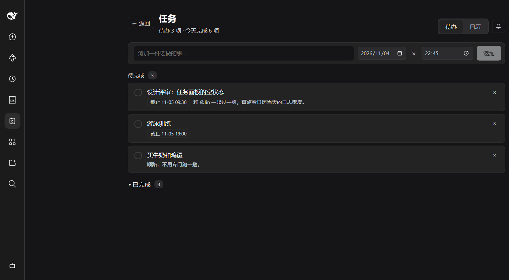
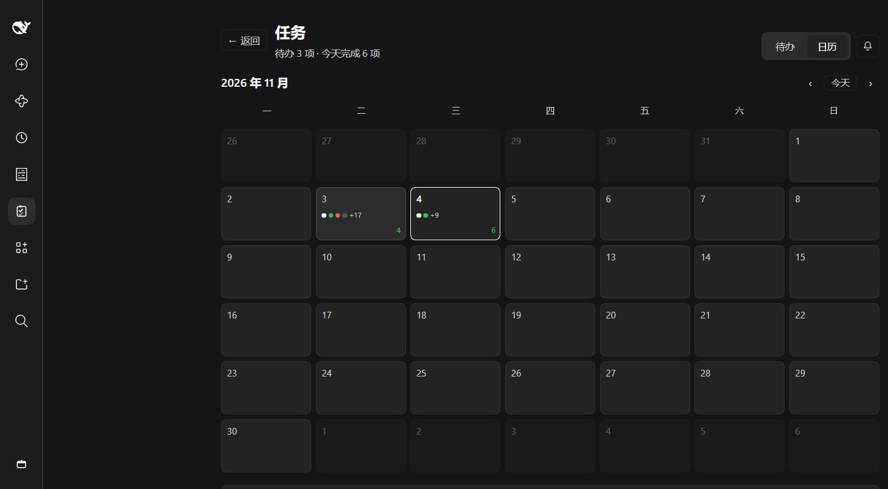
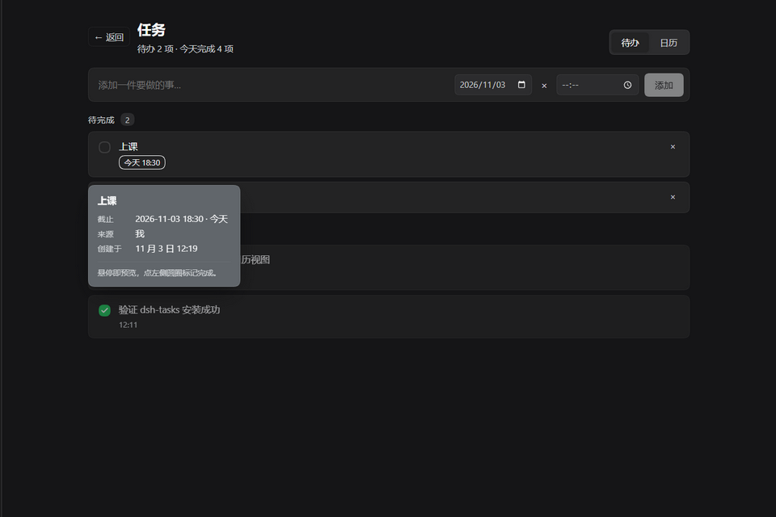
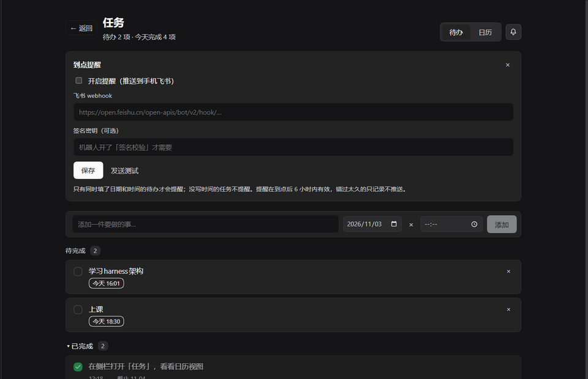
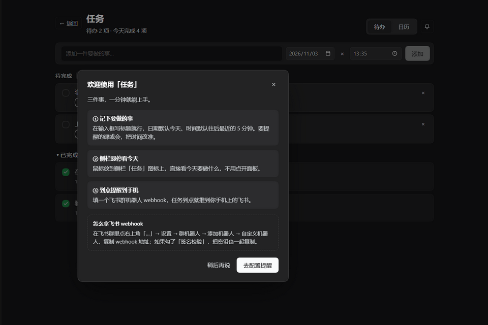

# dsh-tasks-panel

<p align="center">
  <a href="https://github.com/tortoise014/dsh-tasks-panel/actions/workflows/test.yml"></a>
  <a href="https://www.npmjs.com/package/dsh-tasks-panel"></a>
  <a href="https://www.npmjs.com/package/dsh-tasks-panel"></a>
  
  
  
</p>

<p align="center">
  <a href="README.zh-CN.md">中文</a> · <b>English</b>
</p>

<p align="center">
  
</p>

<p align="center"><b>A to-do list, a calendar of what actually happened, and a push at the exact minute — inside DeepSeek Harness.</b></p>

Most task lists ask you to live in them. This one lives where you already work: it is a sidebar
panel of the DeepSeek Harness app, so the agent can add and close tasks through a tool, and you can
check or edit them without leaving the session you were in — plus a Back button that puts you right
back where you were.

## What it does

| | |
| --- | --- |
| 🗂 **Sidebar entry** | One more icon in the rail. Click it for the panel, or use **Back** to return to the session, Plugins, Schedules — whatever you left. |
| ✅ **To do** | Add, complete, reopen, delete. The date defaults to today, the clock to the next five-minute mark, and `×` clears the date for undated notes. |
| 👀 **Today at a glance** | Hover the sidebar icon: a floating agenda lists today's tasks with their times, anything overdue, and how much is still open. No click, no context switch. |
| 🗓 **Calendar** | Every event — added, finished, reopened, edited, deleted — is drawn on the month grid. Click a day to read its log. |
| 💬 **Hover preview** | Point at a task or a day for the full card: title, note, due date and time, source, session, timestamps. Cards dodge the sidebar instead of covering it. |
| ⏰ **Feishu reminders** | Paste a group-bot webhook once. At the due minute the host pushes `⏰ title / time / note` to your phone. |
| 🤖 **Agent tool** | `task_write` lets the assistant add and close tasks — same operations as the UI, so the two never diverge. |

## Screenshots

| Calendar | Hover preview |
| :---: | :---: |
|  |  |
| **Reminder settings** | **First-run guide** |
|  |  |

## Install

```
plugin_manager install_bundle target:"dsh-tasks-panel"
```

Or point `target:"<absolute path to a local checkout>"`. The first time the panel opens, a short
guide walks through the three things worth knowing — write a task, hover the sidebar for today,
paste a webhook for reminders. Both the UI and the guide are bilingual (中文 / English), following
the app's locale.

## Reminders

Reminders follow one rule: **a task is reminded only when it has both a date and a time.** A date
alone is a to-do for the day, not an appointment, so it stays quiet.

| Rule | Why |
| --- | --- |
| The host scans every 30 seconds | DSH must be running; a closed app cannot push. |
| One push per `date` + `time` slot | `notifiedFor` remembers, so a re-start does not re-notify. |
| Moving a task to a new time re-arms it | An appointment that moved deserves a new reminder. |
| A slot more than 6 hours old is marked, not pushed | A laptop asleep overnight should not dump yesterday on you at 9 a.m. |
| The switch saves by itself, webhook included | Pressing the switch then forgetting Save is how "enabled: false" happens. |
| `task_write` has no reminder action | Turning on a push to your phone is your decision, not the agent's. |

The panel shows the last send time and the last delivery error, and **Send a test** proves the phone
receives it before you trust it with anything real. Signature-checked Feishu bots are supported by
pasting the secret too.

## Data

Everything lives in the `dsh_tasks` storage domain: `tasks` and `events` tables plus a `global`
record for reminder settings. The browser half talks to the host over
`POST /api/dsh-tasks-panel/op`. Nothing leaves the machine except the Feishu push itself.

`zod@3.25.76` is vendored under `node_modules/zod` because a bundle installed by link
(`"dsh-tasks-panel": "link:…"`) does not get its dependencies installed by pnpm. An npm install pulls
zod from the registry instead, so the published tarball deliberately does not ship `node_modules`.

## Development

```bash
npm install     # zod for the host half, jsdom + react for the UI suite
npm test        # runs the three suites in order
```

| suite | what it covers |
| --- | --- |
| `node test/host.mjs` (38 checks) | storage ops (`add`/`complete`/`reopen`/`update`/`remove`/`clearCompleted`), time normalisation, the HTTP-op surface, the `task_write` tool |
| `node test/reminders.mjs` (26 checks) | Feishu scheduling: due detection, one push per slot, the six-hour grace window, signature signing, error reporting, the settings guard |
| `node test/ui.mjs` (57 checks) | the client half rendered in jsdom: slot registration, to-do rows, all three hover cards, the compose form's defaults, the first-run guide, the settings card |

Everything runs against the real bundle — no mocks of our own code. The host suites import `index.js`
with a fake Cordis context and in-memory tables; the UI suite loads `client.js` through a stand-in
`window.__ModuleLoader__` and renders the panel into jsdom. No network: Feishu calls go to a stub
`fetch` that records the payload it would have sent.

GitHub Actions runs the same suites on Node 20 and 22 for every push and pull request, and publishes
to npm from a tag through OIDC trusted publishing (`.github/workflows/`).

## License

[MIT](LICENSE)
