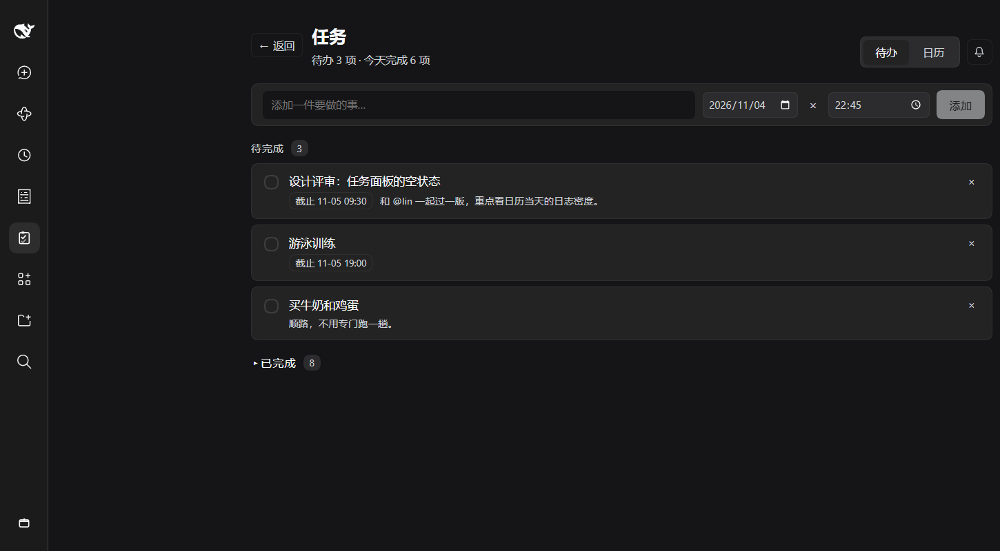
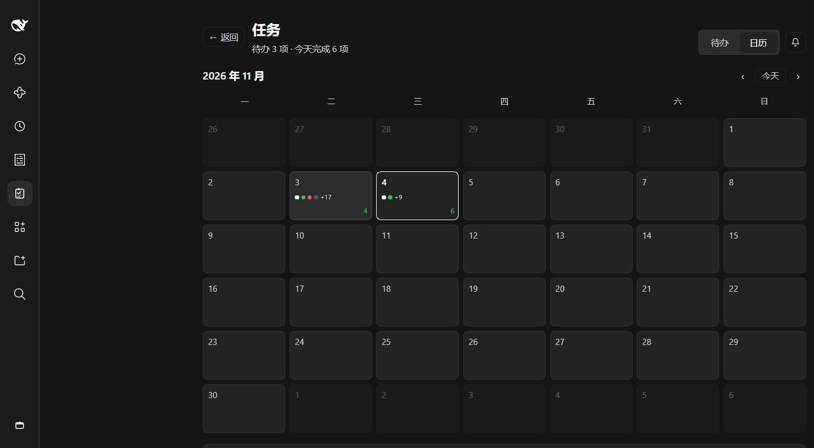
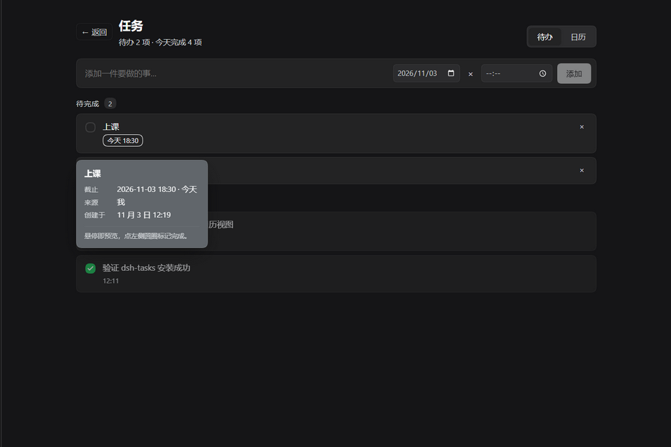
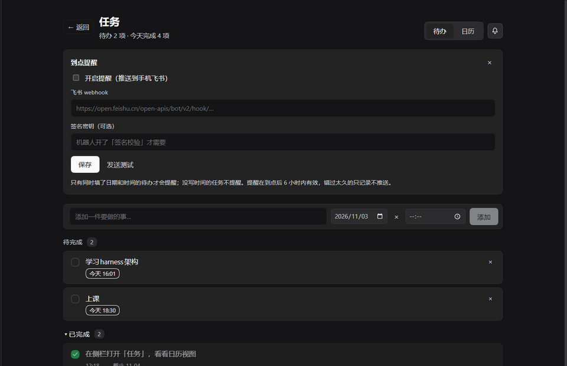
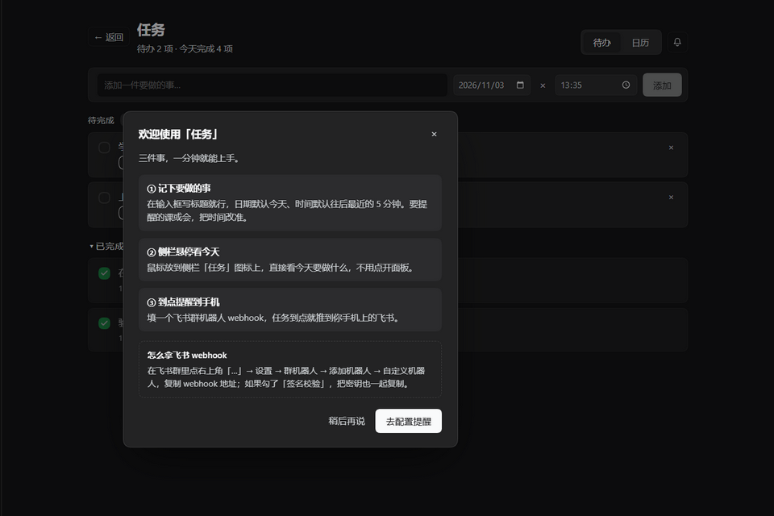

# dsh-tasks-panel

<p align="center">
  <a href="https://github.com/tortoise014/dsh-tasks-panel/actions/workflows/test.yml"></a>
  <a href="https://www.npmjs.com/package/dsh-tasks-panel"></a>
  <a href="https://www.npmjs.com/package/dsh-tasks-panel"></a>
  
  
  
</p>

<p align="center">
  <b>中文</b> · <a href="README.md">English</a>
</p>

<p align="center">
  
</p>

<p align="center"><b>一个待办清单、一个能回看「每天发生了什么」的月历，还有到点推到你手机上的提醒 —— 都在 DeepSeek Harness 里面。</b></p>

大多数待办清单要你专门去用它。这个住在你已经在工作的地方：它是 DeepSeek Harness 的一个侧栏面板，助手可以通过工具加任务、勾任务，你也可以不离开当前会话就查看和修改；面板还带一个「返回」，看完直接回到刚才那个会话。

## 功能一览

| | |
| --- | --- |
| 🗂 **侧栏入口** | 侧栏多一个图标。点开是面板，点「返回」回到你进来之前所在的地方（会话、插件、自动化任务……）。 |
| ✅ **待办** | 添加、完成、重新打开、删除。日期默认今天，时间默认下一个 5 分钟整点，`×` 清空日期就变成没有截止日的备忘。 |
| 👀 **今天一眼看完** | 悬停侧栏图标浮出今日日程：今天的任务与时刻、已逾期的事项、还有多少没完成 —— 不用点开、不打断当前状态。 |
| 🗓 **日历** | 每个事件（新增、完成、重新打开、编辑、删除）都画在月网格上；点某一天读那天完整的记录。 |
| 💬 **悬停预览** | 鼠标指向任务或某一天，浮出完整卡片：标题、备注、截止日期与时间、来源、会话、时间戳。卡片会避让侧栏，而不是盖住它。 |
| ⏰ **飞书到点提醒** | 粘一次群机器人 webhook。到点那一刻，宿主把 `⏰ 标题 / 时间 / 备注` 推到你手机，并把任务标记完成 —— 已经发生的约会不该还躺在列表里等你点一下。 |
| 🤖 **助手工具** | `task_write` 让助手添加、完成任务 —— 和 UI 是同一套操作，所以两边永远不会各记一份。 |

## 截图

| 日历 | 悬停预览 |
| :---: | :---: |
|  |  |
| **提醒设置** | **首次使用引导** |
|  |  |

## 安装

```
plugin_manager install_bundle target:"dsh-tasks-panel"
```

也可以用 `target:"<本地仓库的绝对路径>"` 装本地版本。第一次打开面板会出现一个简短引导（写一条任务、悬停侧栏看今天、粘贴 webhook 配提醒），文案跟随应用语言，中文 / English 都有。

## 提醒规则

只有一条总规则：**同时有日期和时间的任务才提醒。** 只有日期的是「今天要做的事」，不是约会，所以保持安静。

| 规则 | 为什么 |
| --- | --- |
| 宿主每 30 秒扫描一次 | DSH 得开着；应用关着没法推送。 |
| 每个 `日期` + `时间` 只推一次 | `notifiedFor` 记住，重启不会再吵一遍。 |
| 改到新时间会重新提醒 | 改期的约物理应再响一次。 |
| 过去超过 6 小时的时段只标记、不补推 | 笔记本睡一晚，不该在早上九点被昨天的安排刷屏。 |
| 开关自带保存（连 webhook 一起存） | 「点了开关却忘了保存」正是 `enabled: false` 的经典成因。 |
| 推送成功就把任务标记完成 | 约会已经发生，回来再点一次是纯体力活；不想要可以关掉「推送后自动标记完成」。 |
| 只有真推送才自动完成 | 因为超过 6 小时被静默跳过的任务保持未完成 —— 沉默不等于做完。 |
| `task_write` 没有开关提醒的动作 | 要不要推到你手机是你的决定，不是助手的。 |

设置卡会显示最近一次发送时间和最近一次投递错误；**发送测试**能在你真正依赖它之前证明手机收得到。飞书机器人开了签名校验，把密钥也填进去即可。

## 数据

全部存在 `dsh_tasks` 存储域：`tasks`、`events` 两张表，外加一条 `global` 记录保存提醒设置。浏览器半边通过 `POST /api/dsh-tasks-panel/op` 和宿主通信。除了飞书推送本身，没有任何数据离开这台机器。

`zod@3.25.76` 以 vendored 形式放在 `node_modules/zod`，因为用 link 安装的 bundle（`"dsh-tasks-panel": "link:…"`）pnpm 不会给它装依赖。从 npm 安装时会正常从 registry 拉 zod，所以发布的 tarball 故意不带 `node_modules`。

## 开发

```bash
npm install     # 宿主半边的 zod，UI 测试用的 jsdom + react
npm test        # 依次跑下面三套
```

| 测试 | 覆盖什么 |
| --- | --- |
| `node test/host.mjs`（38 项） | 存储操作（`add`/`complete`/`reopen`/`update`/`remove`/`clearCompleted`）、时间规范化、HTTP op 接口、`task_write` 工具 |
| `node test/reminders.mjs`（34 项） | 飞书调度：到期判定、每个时段只推一次、6 小时宽限、推送后自动完成、升级前已提醒任务的一次性归位、签名、错误上报、设置校验 |
| `node test/ui.mjs`（65 项） | 在 jsdom 里渲染的浏览器半边：slot 注册、待办行、三种悬停卡、添加表单的默认值、首次引导、带两个开关的提醒设置卡 |

全部对着真实的 bundle 跑，不 mock 自己的代码。宿主套件用假的 Cordis context 和内存表 import `index.js`；UI 套件通过假的 `window.__ModuleLoader__` 加载 `client.js`，把面板渲染进 jsdom。全程不联网：飞书调用是打桩的 `fetch`，只记录它本来会发出去的 payload。

GitHub Actions 在每次 push 和 pull request 上用 Node 20 和 22 跑同一套测试，并用 OIDC trusted publishing 从 tag 发布到 npm（见 `.github/workflows/`）。

## 许可证

[MIT](LICENSE)
